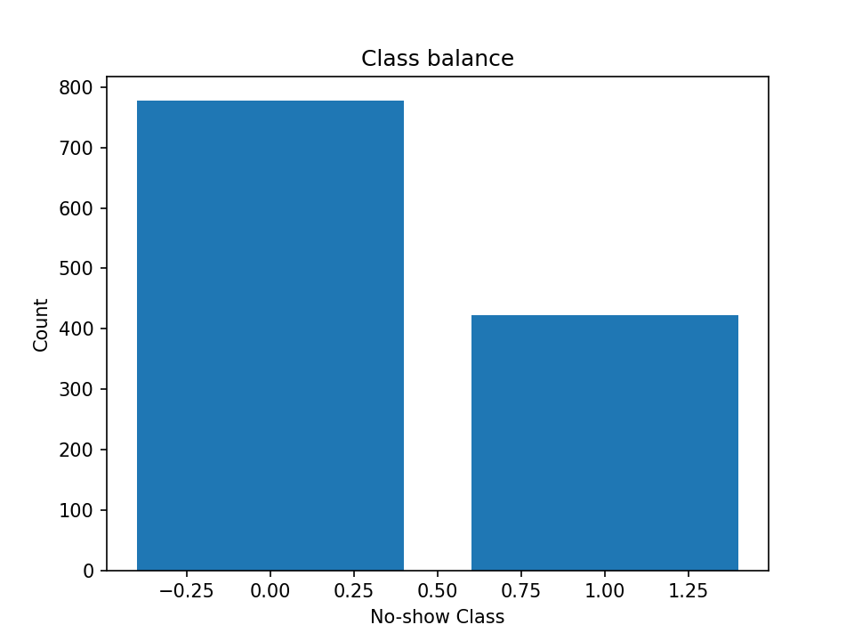
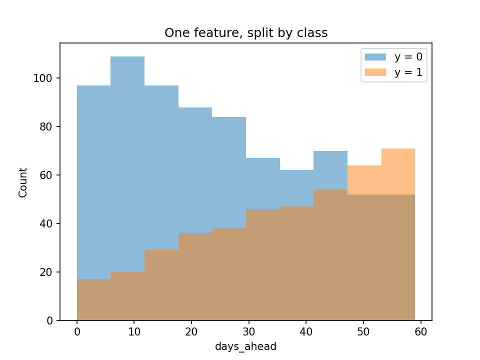
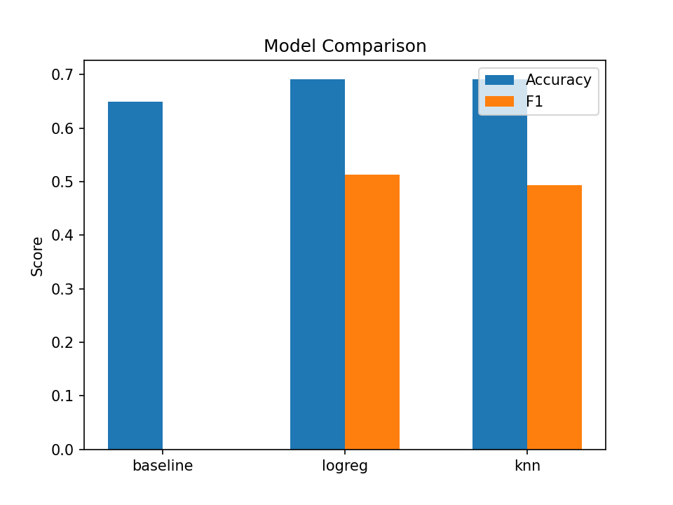

# Lab 2 Report — {20231879} {LeeJeongyeon}

## 1. What I did
I followed the provided skeleton without changing the function interfaces. For classification, I used a stratified, seeded, leak-free train/validation split and compared the majority-class baseline, logistic regression, and kNN under identical conditions for regression, I used the same discipline with the predict-the-mean baseline, linear regression, and kNN. 

## 2. Results

**Table 1. All three models under one split, one seed, one metric definition.** 
The majority-class baseline achieves 0.65 accuracy because the majority class accounts for about 65% of the data, but its precision, recall, and F1 are all 0 because it never predicts the positive class.

| Model | Accuracy | Precision | Recall | F1 |
|-------|----------|-----------|--------|----|
| baseline (majority) | 0.65 | 0.0 | 0.0 | 0.0 |
| logistic regression | 0.6917 | 0.5735 | 0.4643 | 0.5132 |
| kNN (k=15) | 0.6917 | 0.5806 | 0.4286 | 0.4932 |

**Table 2. Regression on `wait_minutes`, same discipline.** 
The predict-the-mean baseline has R² close to 0 because R² is measured against predicting the mean both learned models beat this reference point by achieving much lower MAE and RMSE and much higher R².

| Model | MAE | RMSE | R² |
|-------|-----|------|----|
| baseline (mean) | 28.4714 | 32.575 | -0.0056 |
| linear regression | 4.514 | 5.5935 | 0.9704 |
| kNN (k=15) | 6.9887 | 8.7285 | 0.9278 |

## 3. Figures

  

**Figure 1. Class balance of `no_show`.** 
The positive rate is about 35%, so the majority-class baseline is expected to achieve about 65% accuracy by predicting the majority class every time.

  

**Figure 2. `days_ahead` distribution by class.** 
days_ahead provides some class separation, with no-shows tending toward larger values, but the two class distributions still overlap substantially.

  

**Figure 3. Accuracy and F1 by model.** 
The baseline shows that 0.65 accuracy alone is not evidence of learning on imbalanced data, while logistic regression and kNN both find positive cases logistic regression has the higher F1 because its precision and recall produce a higher harmonic mean.

## 4. Interpretation

As shown in Figure 1, about 65% of the samples belong to the majority class (no_show = 0), so the majority-class baseline achieves about 0.65 accuracy simply by predicting the majority class for every input.

Its F1 is 0 because the baseline never predicts the positive class, so both recall and precision are 0 under the specified zero-division convention.

Logistic regression has the highest F1 at 0.5132. Figure 2 shows that days_ahead provides useful class separation, but the substantial overlap also shows that this feature alone cannot perfectly distinguish no-shows from kept appointments.

The scaler must live inside the Pipeline so that its mean and standard deviation are fitted on the training data only standardizing before the split would let the validation rows influence the transform and cause data leakage.

In Table 2, the predict-the-mean baseline has R² close to 0 because R² is measured against predicting the mean it is not exactly 0 because the baseline predicts the training-set mean on the validation data.

Linear regression outperforms kNN on this dataset, suggesting that wait_minutes has an approximately linear relationship with the input features. In contrast, kNN relies on nearby samples in feature space, which appears to be less suitable for this data structure.

## 5. Limitations

A limitation is that the analysis mainly considers individual feature patterns, while combinations of features may also affect no-show behavior. For example, the no-show rate differs across combinations of days_ahead and distance_km, suggesting that feature interactions could provide additional information.

## AI & external-code usage

| Tool / Source | Part used for | What I modified & verified myself |
|---------------|---------------|-----------------------------------|
| ChatGPT | Explanation of NumPy, pandas, and Matplotlib syntax needed for the TODOs and plots; debugging syntax errors; interpretation of the report requirements; English rewriting of report sentences that I first wrote in Korean; and help drafting the submission README. | I read each TODO and developed the implementation logic myself, then implemented the code using the syntax explanations. I reviewed and modified the code after debugging, checked the generated outputs and plots, wrote the report content in Korean before asking ChatGPT to refine it in English, and reviewed the final README before submission. |

