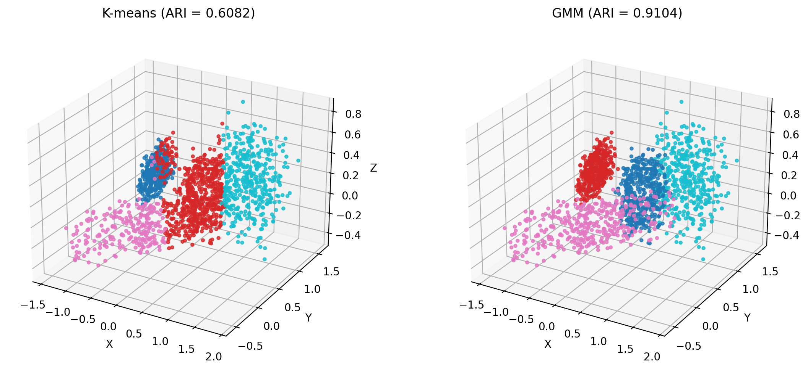
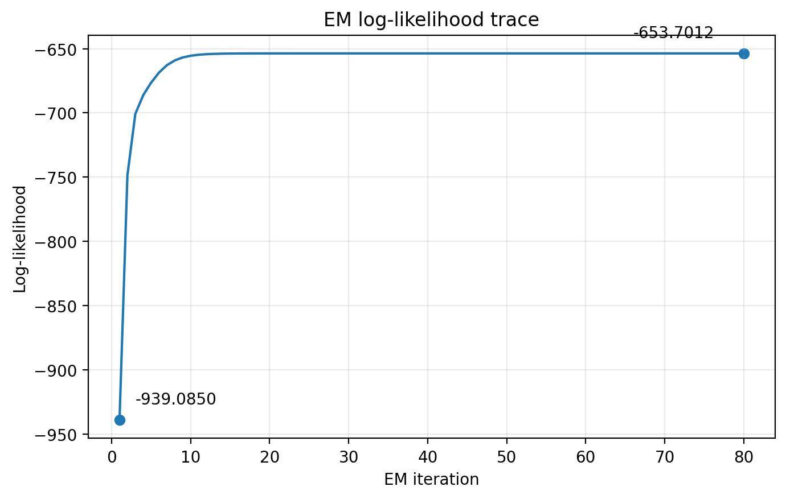
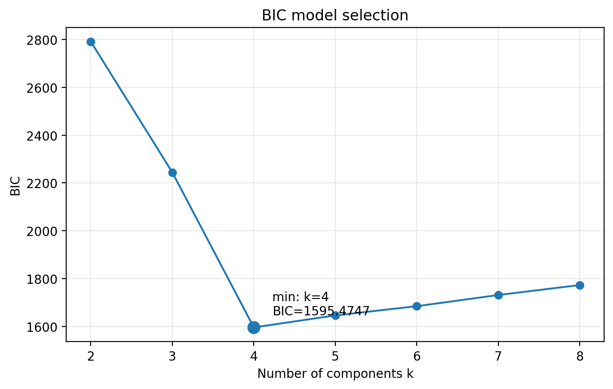

# Lab 3 Report — 20231879 LeeJeongyeon

## 1. What I did
I followed the provided algorithmic specification without adding additional preprocessing or clustering methods. The implementation preserves the prescribed RNG flow and uses the ground-truth labels only for ARI evaluation in run_experiment. The GMM E-step was computed in log space using log-sum-exp, with reg * I added to every estimated covariance as specified.

## 2. Results

**Table 1. Key numbers from `results.json`.** The main result is the ARI improvement from 0.6082 for K-means to 0.9104 for the full-covariance GMM, while BIC selects k = 4.

| Metric | Value |
|--------|-------|
| ARI, K-means / GMM | 0.6082 / 0.9104 |
| K-means inertia | 281.8135 |
| Log-likelihood, first / final / min consecutive change | -939.0850 / -653.7012 / -0.000000007 |
| BIC at k = 3 / 4 / 5 | 2244.1721 / 1595.4747 / 1645.8338 |
| Selected k (BIC minimum) | 4 |

## 3. Figures

    

**Figure 1. The scene colored by K-means labels and by GMM labels.** K-means reaches an ARI of 0.6082 and produces more fragmented assignments on anisotropic objects, whereas the full-covariance GMM reaches 0.9104 and better captures the anisotropic cluster shapes.

    

**Figure 2. EM log-likelihood vs iteration.** The log-likelihood increases rapidly from -939.0850 and reaches a plateau near -653.7012. The minimum consecutive change is only -7 × 10⁻⁹, which is consistent with the small effect of covariance regularization and numerical precision.

    

**Figure 3. BIC vs number of components k.** BIC reaches its minimum at k = 4 with a value of 1595.4747. It decreases strongly up to k = 4 and then increases as the complexity penalty outweighs the additional improvement in fit.

## 4. Interpretation

 As shown in Figure 1, K-means splits the elongated box and merges some of its points with the spherical shell because isotropic Euclidean distance cannot capture the elongated object’s direction-dependent spread; this limitation is also reflected in the lower K-means ARI reported in Table 1.

 As shown in Figure 1, the full-covariance GMM reduces K-means errors because it can model each cluster’s direction and anisotropic spread, allowing elongated or flat objects to be represented more accurately. This is also reflected in the higher GMM ARI in Table 1.

 Increasing k gives the GMM more parameters and can improve the log-likelihood by fitting the data more closely. As shown in Figure 3, BIC additionally penalizes this increased model complexity, and the resulting trade-off gives the minimum BIC at k=4.

 For a point midway between two objects, the responsibilities would likely be shared between the two corresponding components rather than forming a hard one-hot assignment. The exact values would depend on the components’ means, covariances, and weights.

## 5. Limitations

One limitation is that the BIC-selected k does not necessarily match the true number of objects. If a single object has a multi-modal shape, such as a snowman-like object with two separated parts, modeling it with two Gaussian components may fit the data better than forcing one component to cover both parts, so the optimal k could be larger than the number of objects.

## AI & external-code usage
| Tool / Source | Part used for | What I modified & verified myself |
|---------------|---------------|-----------------------------------|
| ChatGPT | Explanation of NumPy, and Matplotlib syntax needed for the TODOs and plots; debugging syntax errors; interpretation of the report requirements; English rewriting of report sentences that I first wrote in Korean; and help drafting the submission README. | I read each TODO and developed the implementation logic myself, then implemented the code using the syntax explanations. I reviewed and modified the code after debugging, checked the generated outputs and plots, wrote the report content in Korean before asking ChatGPT to refine it in English, and reviewed the final README before submission. |
