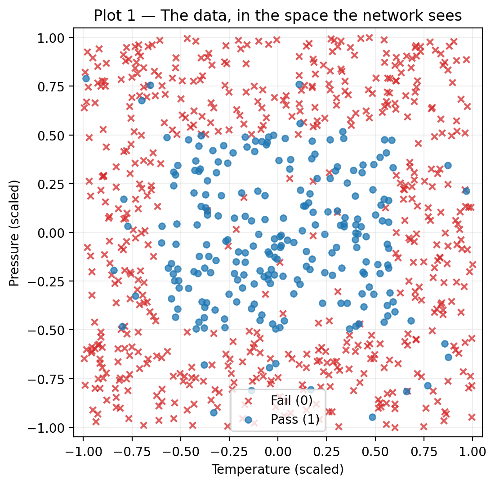
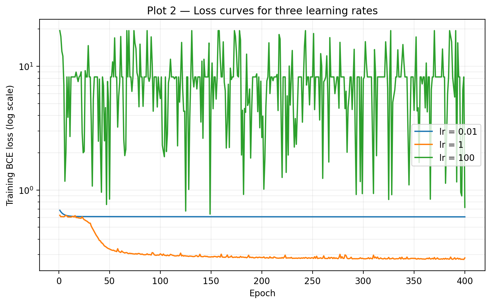
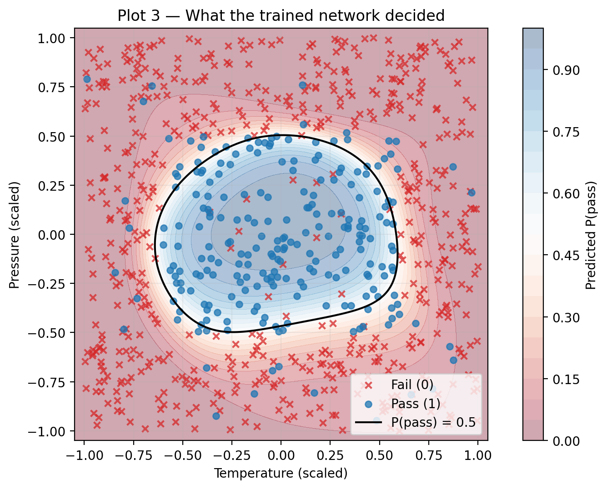

# Lab 4-1 Report — 20231879 LeeJeongyeon

## 1. What I did

I used `np.ndindex` to check every parameter entry directly against central finite differences. Each perturbed entry is restored in a `finally` block so the original parameter value is preserved even if loss evaluation fails.

## 2. Results

**Table 1. Gradient check.** The maximum relative error of 9e-08 is below 1e-6, confirming agreement between the analytic and numerical gradients on the checked batch before training.

| Quantity | Value |
|----------|-------|
| max relative error, analytic vs numerical gradient | 9e-08 |
| pass threshold | 1e-6 |

**Table 2. Three learning rates, one split, one seed, one initialization.** Max train loss exposes the unstable run most clearly, because its final train loss alone cannot show the large fluctuations during training.

| Learning rate | Final train loss | Max train loss | Final val loss | Final val accuracy | Best val accuracy |
|---------------|------------------|----------------|----------------|--------------------|-------------------|
| 0.01 | 0.6065 | 0.6853 | 0.6049 | 0.7063 | 0.7063 |
| 1.0 | 0.2822 | 0.6247 | 0.3608 | 0.8812 | 0.8938 |
| 100.0 | 0.7231 | 19.4281 | 0.7168 | 0.7063 | 0.7063 |
| majority-class baseline (validation split) | n/a | n/a | n/a | 0.7063 | n/a |

## 3. Figures

    

**Figure 1. The two press settings, coloured by outcome.** Passing parts are mainly concentrated in a central rectangle in the space of scaled temperature and pressure. Some passing parts lie outside this region and some failing parts lie inside it.

    

**Figure 2. Training loss against epoch for three learning rates.** At lr = 0.01, training loss changes little after the initial drop, while lr = 1.0 produces a sustained decrease toward a low plateau. At lr = 100, the loss repeatedly spikes and drops, showing unstable updates.

    

**Figure 3. Decision boundary of the trained network.** The contour at a predicted probability of 0.5 encloses a rounded region that approximates the central rectangle in Figure 1. It misses some passing parts near the rectangle's corners and includes some failing parts inside the boundary.

## 4. Interpretation

Figure 1 shows a passing region surrounded by failing parts, so one straight decision boundary cannot separate the rectangle's inside from its outside. Multiple sigmoid hidden units combine soft boundaries, enabling the closed region shown in Figure 3.

In Figure 2, lr = 0.01 is too small for the budget of 400 epochs because training loss soon stays near 0.6065. With lr = 1.0, the loss decreases overall and Table 2 shows a final validation accuracy of 0.8812, above the validation majority-class baseline of 0.7063, so this step size is usable. At lr = 100, the step size is too large, causing repeated overshooting and large loss fluctuations.

The final training loss of 0.7231 at lr = 100 is only the last point on the fluctuating curve in Figure 2. Table 2 records a max train loss of 19.4281, which reveals the instability hidden by the much smaller final value.

The gradient check tests whether the analytic gradients from `backward()` agree with central finite differences before any parameter updates. The small error in Table 1 helps distinguish a gradient implementation problem from the step size effects shown in Figure 2.

## 5. Limitations

The comparison uses only one train/validation split and one initialization with seed 42.
Different seeds could change the split, initial weights, and resulting decision boundary.
The validation accuracy in Table 2 may therefore vary across runs.
Repeating the comparison across seeds would test whether lr = 1.0 remains best among the three rates.

## AI & external-code usage

(Required. Leave the table empty only if you used nothing — see README §6.)

| Tool / Source | Part used for | What I modified & verified myself |
|---------------|---------------|-----------------------------------|
| ChatGPT | Explanation of NumPy, and Matplotlib syntax needed for the TODOs and plots; debugging syntax errors; interpretation of the report requirements; English rewriting of report sentences that I first wrote in Korean; and help drafting the submission README. | I read each TODO and developed the implementation logic myself, then implemented the code using the syntax explanations. I reviewed and modified the code after debugging, checked the generated outputs and plots, wrote the report content in Korean before asking ChatGPT to refine it in English, and reviewed the final README before submission. |

