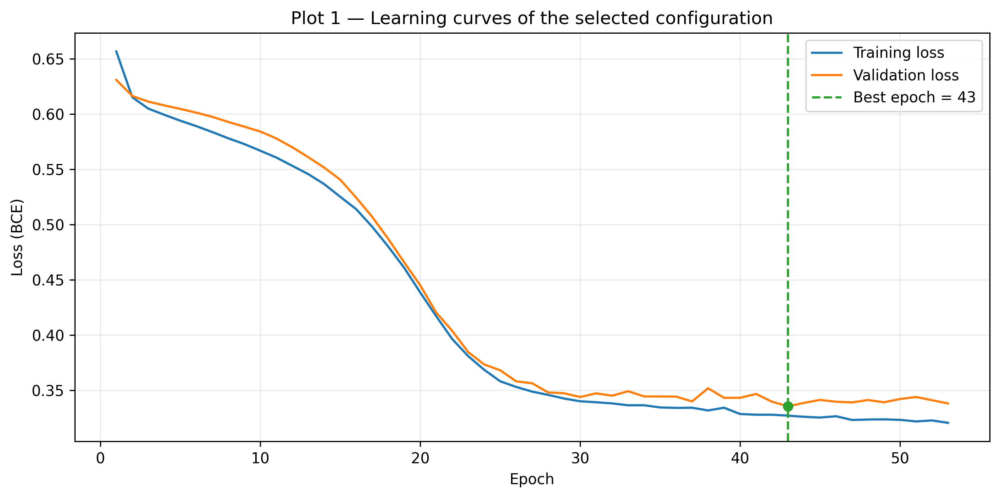
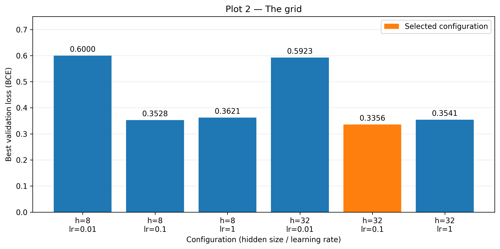
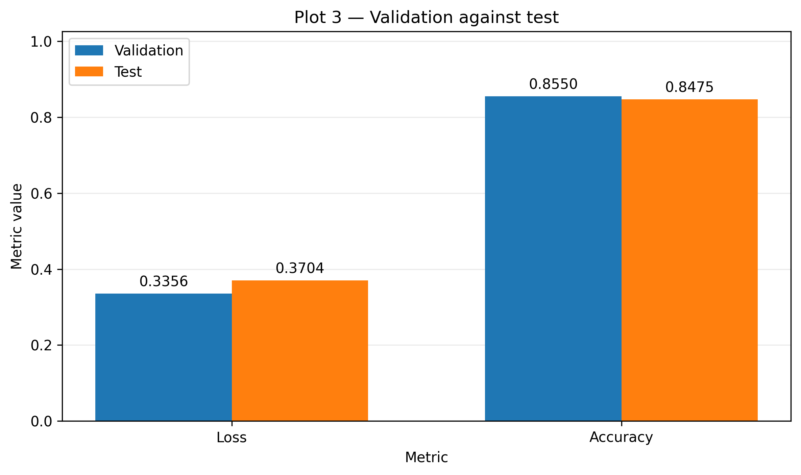

# Lab 4-2 Report — 20231879 LeeJeongyeon

## 1. What I did

I followed the provided skeleton without changing the model architecture, function interfaces, or fixed experiment settings. I retained each trained model alongside its grid record, allowing `run_experiment` to evaluate the selected model directly after the search.

## 2. Results

**Table 1. Six configurations scored on validation, one of them scored on test.** The configuration with hidden size 32 and learning rate 0.1 was selected because it had the lowest validation loss, 0.335632.

| Hidden size | Learning rate | Best epoch | Epochs run | Validation loss | Validation accuracy |
|-------------|---------------|------------|------------|-----------------|---------------------|
| 8 | 0.01 | 80 | 80 | 0.600035 | 0.700000 |
| 8 | 0.1 | 52 | 62 | 0.352824 | 0.867500 |
| 8 | 1.0 | 15 | 25 | 0.362131 | 0.850000 |
| 32 | 0.01 | 80 | 80 | 0.592339 | 0.700000 |
| 32 | 0.1 | 43 | 53 | 0.335632 | 0.855000 |
| 32 | 1.0 | 20 | 30 | 0.354082 | 0.870000 |

Selected configuration: hidden size 32, learning rate 0.1.
Test loss 0.370398, test accuracy 0.847500, measured once after the grid search was complete.

## 3. Figures

  

**Figure 1. Training and validation loss of the selected configuration.** After about epoch 30, training loss continues to decrease while validation loss levels off and fluctuates. Early stopping ended training at epoch 53 and restored the weights from epoch 43, where validation loss was lowest at 0.335632.

  

**Figure 2. Validation loss across the grid.** Changing the learning rate from 0.01 to 0.1 reduced validation loss by 0.247211 for hidden size 8 and 0.256707 for hidden size 32. Increasing hidden size from 8 to 32 reduced loss by only 0.007696–0.017192 across the three learning rates, so learning rate had the larger effect.

  

**Figure 3. Validation against test for the selected configuration.** Test loss was 0.034766 higher than validation loss, while test accuracy was 0.007500 lower, a gap of 0.75 percentage points.

## 4. Interpretation

In Table 1, the configurations with hidden sizes 8 and 32 at learning rate 0.01 both achieve validation accuracy 0.700000, matching a model that always predicts `needs_service = 0`. Their best epochs are both 80, suggesting that the small SGD parameter updates make insufficient progress within the epoch budget to improve accuracy beyond the majority-class baseline.

Figure 1 shows that training loss continues to decrease after about epoch 30 while validation loss fluctuates near its minimum. Continuing to epoch 80 could have produced further fluctuation or increased validation loss as the model fitted training-specific noise, but epochs 54–80 were not run, so their exact losses are unknown.

As shown in Table 1 and Figure 2, hidden size 32 and learning rate 0.1 were selected by validation loss 0.335632, although hidden size 32 and learning rate 1.0 had higher validation accuracy, 0.870000, with a worse loss of 0.354082. `BCEWithLogitsLoss` also reflects prediction confidence and penalizes confident errors, while accuracy only counts correct predictions after comparing logits with zero.

In Figure 3, the same weights are evaluated on different sets of 400 samples, so loss and accuracy can differ through sampling variation. Validation also determined the best epoch and configuration, which can make its score optimistic and help explain the slightly worse test result.

## 5. Limitations

The six configurations were compared on one validation split with seed 42.
Its 400 samples determined both the best epoch and the selected configuration.
A different split could change the ranking in Table 1 and the validation–test gap.
Repeated splits or cross-validation would help check whether hidden size 32 and learning rate 0.1 remain the best choice.

## AI & external-code usage

(Required. Leave the table empty only if you used nothing — see README §6.)

| Tool / Source | Part used for | What I modified & verified myself |
|---------------|---------------|-----------------------------------|
| ChatGPT | Explanation of NumPy, and Matplotlib syntax needed for the TODOs and plots; debugging syntax errors; interpretation of the report requirements; English rewriting of report sentences that I first wrote in Korean; and help drafting the submission README. | I read each TODO and developed the implementation logic myself, then implemented the code using the syntax explanations. I reviewed and modified the code after debugging, checked the generated outputs and plots, wrote the report content in Korean before asking ChatGPT to refine it in English, and reviewed the final README before submission. |
