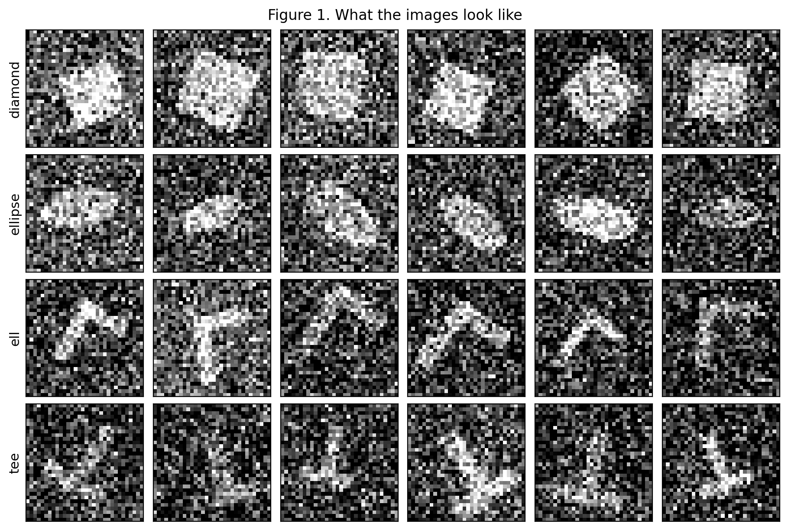
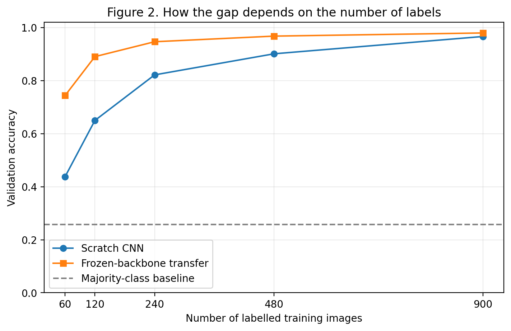
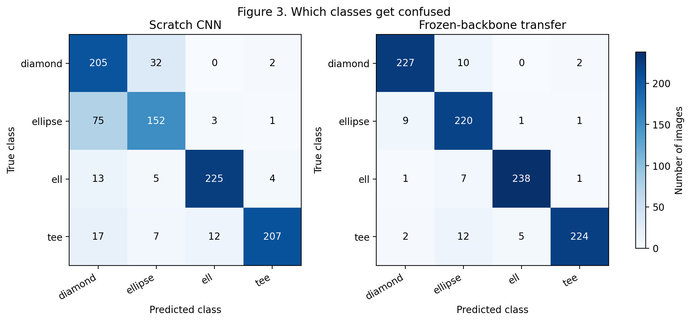

# Lab 5 Report — 20231879 LeeJeongyeon

## 1. What I did

I followed the provided skeleton without changing the architecture, function interfaces, or fixed training settings. For the transfer model, I loaded only the pretrained 'features.*' weights and retained the freshly initialized four-class head.

## 2. Results

**Table 1. Both models under one split, one seed, one training budget.** Table 1 compares validation accuracy against the majority-class baseline and the number of trainable parameters, using 240 labelled training images and seed 42.

| Model | Validation accuracy | Trainable parameters |
|-------|---------------------|----------------------|
| baseline (most frequent class) | 0.2573 | 0 |
| CNN from scratch | 0.8219 | 7,940 |
| frozen backbone + new head | 0.9469 | 2,052 |

## 3. Figures

  

**Figure 1. Sample images, one row per class.** Samples within each class vary in position, size, orientation, and pixel noise. Some diamond and ellipse samples have similar filled shapes with noisy boundaries, suggesting that these classes could be confused.

  

**Figure 2. Accuracy against the label budget.** As the label budget increases from 60 to 900, scratch accuracy rises from 0.4377 to 0.9667 and transfer accuracy from 0.7439 to 0.9800. The gap narrows from 30.62 to 1.33 percentage points, but the curves do not meet within the measured range.

  

**Figure 3. Confusion matrices, scratch against transfer.** The combined errors between diamond and ellipse decrease from 107 for scratch to 19 for transfer, remaining the largest confusion pair in both models. This confusion is consistent with the visually similar noisy shapes in Figure 1.

## 4. Interpretation

Table 1 shows that the transfer model updates 2,052 of 7,940 parameters, or 25.84%, while achieving validation accuracy 12.50 percentage points higher than scratch. It reuses a backbone pretrained on 9,000 images of six other shape classes, whereas scratch learns both the backbone and head from the 240 labelled training images. Reusing pretrained features allows the transfer model to learn only a new classification head from the limited labelled data, instead of learning the feature extractor from scratch.

The majority-class baseline predicts ell and reaches 0.2573 accuracy, close to one quarter. This is consistent with the roughly balanced distribution of the four classes.

In the transfer model, features parameters have 'requires_grad=False' and are excluded from the optimizer. Backpropagation stops at the boundary between the head and frozen backbone, so only head is updated. Unfreezing the backbone and including its parameters in the optimizer would allow all 7,940 parameters to be fine-tuned; the resulting accuracy was not measured.

Figure 3 shows that diamond and ellipse remain a difficult pair after transfer, although their combined errors decrease substantially. Their similar appearances under pixel noise in Figure 1 provide a possible explanation for this confusion.

## 5. Limitations

The advantage observed with 240 labels does not remain constant as more labels are added: Figure 2 shows a gap of 30.62 percentage points at 60 labels and 1.33 points at 900 labels. Transfer therefore provides a larger accuracy benefit when labels are scarce in this experiment. However, the validation set also changes with each budget, so a fixed held-out set would be needed to compare the label budgets on the same evaluation data.

## AI & external-code usage

| Tool / Source | Part used for | What I modified & verified myself |
|---------------|---------------|-----------------------------------|
| ChatGPT | Explanation of NumPy, and Matplotlib syntax needed for the TODOs and plots; debugging syntax errors; interpretation of the report requirements; English rewriting of report sentences that I first wrote in Korean; and help drafting the submission README. | I read each TODO and developed the implementation logic myself, then implemented the code using the syntax explanations. I reviewed and modified the code after debugging, checked the generated outputs and plots, wrote the report content in Korean before asking ChatGPT to refine it in English, and reviewed the final README before submission. |
