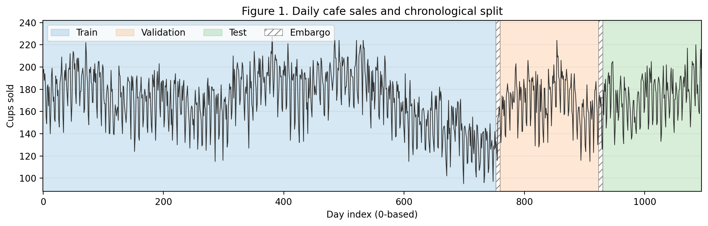
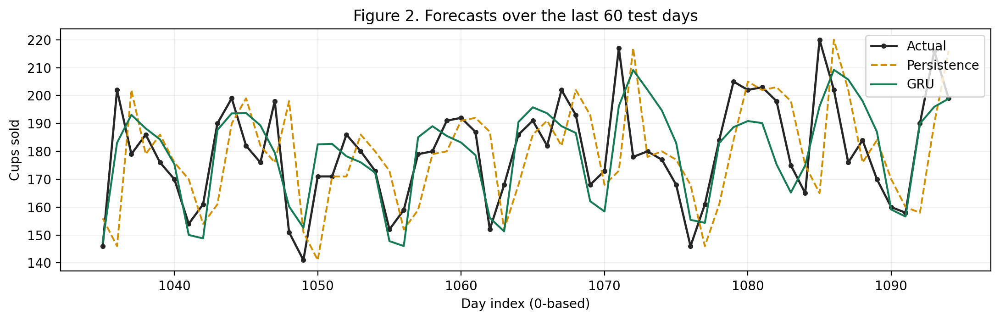
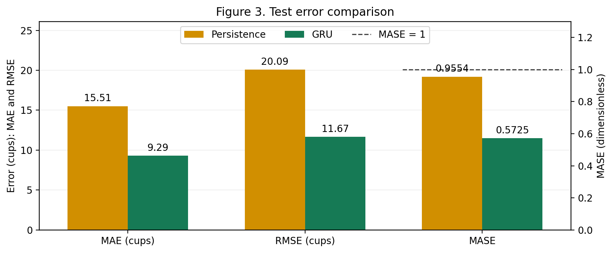

# Lab 6 Report — 20231879 LeeJeongyeon

## 1. What I did

I followed the provided skeleton without changing the function interfaces, fixed experiment settings, or supplied training loop. Windows were constructed separately within each chronological segment, and the standardisation constants and naive_scale were computed from the training segment only.

## 2. Results

**Table 1. Both forecasters on the same test windows, one split, one seed.** The persistence baseline achieves a test MASE of 0.9554, which the GRU must improve on to outperform repeating yesterday's sales.

| Forecaster | MAE (cups) | RMSE (cups) | MASE |
|------------|------------|-------------|------|
| persistence (yesterday) | 15.5067 | 20.0934 | 0.9554 |
| GRU (window 14) | 9.2924 | 11.667 | 0.5725 |

Split sizes (windows): train 739 / validation 150 / test 150.
Scaling constants, from the training segment only: mean 170.4754 , std 25.5496 .

## 3. Figures

  

**Figure 1. The series and the chronological split.** Training occupies days 0–752, validation days 760–923, and test days 931–1094, using zero-based day indices. The two white strips mark seven-day embargo gaps excluded between consecutive segments.

  

**Figure 2. Actual, persistence and RNN forecasts over the last 60 test days.** Persistence has its largest errors at sharp changes, including the Monday increases at days 1036 and 1085 and the Saturday decrease at day 1048. These days coincide with transitions between weekday and weekend sales levels.

  

**Figure 3. Test error for the two forecasters.** MAE measures error in cups, whereas MASE expresses it relative to the training segment's mean absolute one-step change. Both MASE values are below 1, and the GRU has lower MAE, RMSE, and MASE than persistence.

## 4. Interpretation

Table 1 shows that persistence achieves a test MASE of 0.9554. Repeating the most recent observation retains the current sales level, which is useful when sales change little from one day to the next. However, Figure 2 shows that this forecast follows sharp changes one day late, producing large errors at weekend decreases and Monday increases.

The GRU receives 14 consecutive cups values, covering two weekly cycles, and uses the last hidden state for prediction. It does not receive an explicit weekday feature. In Figure 2, its forecasts follow several recurring decreases and recoveries more closely than persistence, although some sharp peaks remain underestimated. Table 1 records a lower test MAE of 9.2924 cups for the GRU, compared with 15.5067 cups for persistence.

Figure 3 provides a scale-relative interpretation of these errors. The naive_scale is 16.2314 cups, computed from consecutive observations in the training segment only. The GRU's MASE of 0.5725 means that its test MAE is approximately 57.25% of this reference movement. Persistence need not have a test MASE of exactly 1 because its test error and the training reference are computed over different periods.

Figure 1 preserves the order in which observations become available. Shuffling before splitting could place later observations in training while earlier observations are evaluated, causing future information to enter the comparison. MAE, RMSE, and MASE could consequently become artificially low; no shuffled experiment was performed to measure this effect.

## 5. Limitations

The comparison uses one chronological split with seed 42. Figure 1 shows that the sales level changes over time, so a different test period could change both forecasters' errors and the size of the GRU's advantage. Walk-forward validation would be needed to check whether the improvement persists across multiple chronological test periods.

## AI & external-code usage

| Tool / Source | Part used for | What I modified & verified myself |
|---------------|---------------|-----------------------------------|
| ChatGPT | Explanation of NumPy, and Matplotlib syntax needed for the TODOs and plots; debugging syntax errors; interpretation of the report requirements; English rewriting of report sentences that I first wrote in Korean; and help drafting the submission README. | I read each TODO and developed the implementation logic myself, then implemented the code using the syntax explanations. I reviewed and modified the code after debugging, checked the generated outputs and plots, wrote the report content in Korean before asking ChatGPT to refine it in English, and reviewed the final README before submission. |
