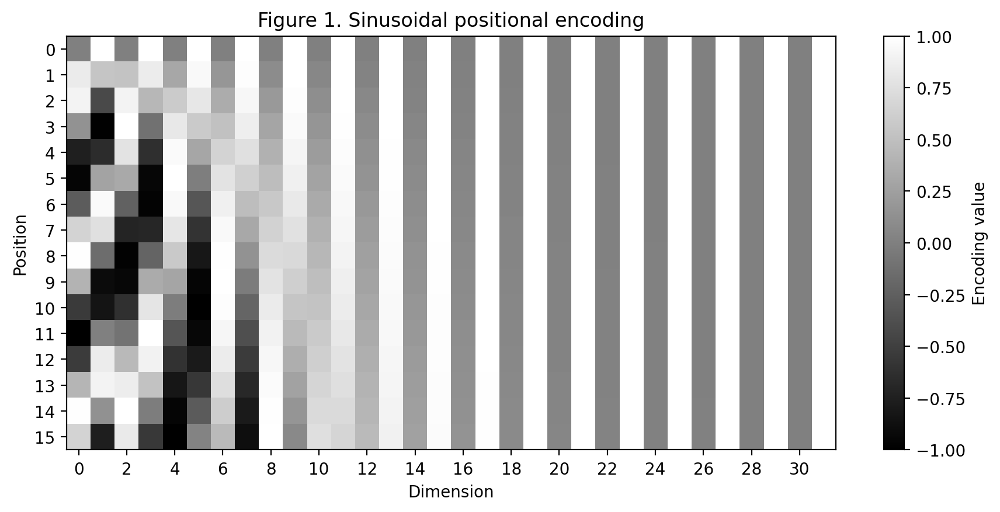
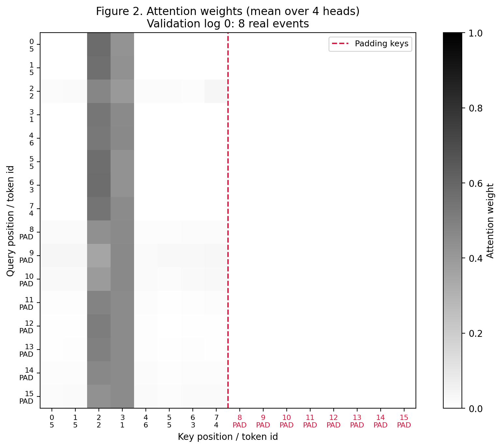
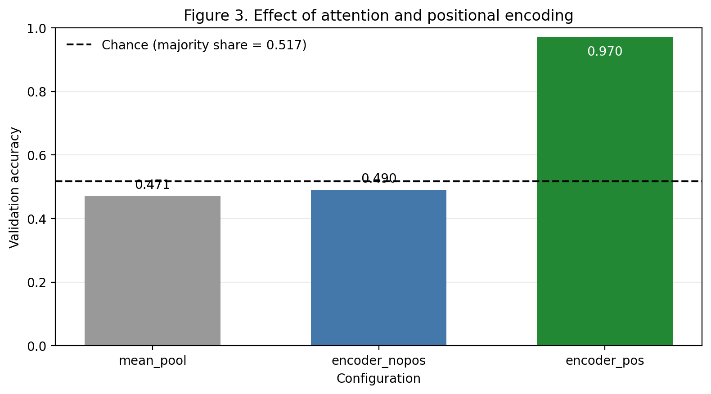

# Lab 7 Report — 20231879 LeeJeongyeon

## 1. What I did

I followed the provided skeleton without changing the function interfaces, fixed model settings, or supplied training loop. After completing the TODO blocks, I checked all six public tests and verified that two executions produced identical results except for `runtime_seconds`.

## 2. Results

**Table 1. Three configurations, one dataset, one seed, one training recipe.** Only the attention and positional encoding flags differ across configurations; the data split, seed, optimizer, learning rate, batch size, and number of epochs remain fixed.

| Configuration | Attention | Positional encoding | Val accuracy | Val loss |
|---------------|-----------|---------------------|--------------|----------|
| `mean_pool` | no | no | 0.471 | 0.7018 |
| `encoder_nopos` | yes | no | 0.49 | 0.7003 |
| `encoder_pos` | yes | yes | 0.97 | 0.1335 |

## 3. Figures

  

**Figure 1. The positional encoding matrix.** Rows represent positions 0–15 and columns represent dimensions 0–31, with sin in even dimensions and cos in odd dimensions. The sin/cos pairs vary at different frequencies, giving neighbouring positions similar components while larger position differences change the phase pattern across dimensions.

  

**Figure 2. Attention weights for one validation log.** Rows are query positions and columns are key positions, with attention weights averaged over four heads for validation log 0. Positions 0–7 are real events, while PAD key columns 8–15 lie to the right of the red dashed line and receive exactly zero weight.

  

**Figure 3. Validation accuracy of the three configurations.** The dashed chance line is the validation majority-class share, 0.517. `mean_pool` and `encoder_nopos` achieve 0.471 and 0.490, both below the line, while `encoder_pos` reaches 0.970.

## 4. Interpretation

Table 1 and Figure 3 show that `mean_pool` and `encoder_nopos` remain near the chance line, while `encoder_pos` improves accuracy by 48 percentage points over `encoder_nopos`. The first two configurations cannot distinguish logs containing the same events in different orders: mean pooling is permutation invariant, and self-attention without positional encoding is permutation equivariant, becoming invariant after `masked_mean`. Their chance-level results therefore reflect a structural limitation in representing order.

The positional encoding in Figure 1 is added to the token embeddings, so the same token receives different input vectors at different positions. This allows the encoder to represent whether the heat alarm occurs before the pressure alarm.

In Figure 2, PAD key columns 8–15 receive exactly zero attention weight because their scores are replaced with negative infinity before softmax. PAD query rows are still computed, but their outputs are excluded by `masked_mean`.

Dividing the scores by `sqrt(d_k)` controls the growth in dot-product magnitude as the query/key dimension increases. Without this scaling, softmax would be more likely to saturate and produce small gradients, which could slow learning; an experiment without scaling was not performed.

## 5. Limitations

The experiment used only logs with 8–16 real events, padded to length 16. The observed accuracy therefore does not establish whether `encoder_pos` would maintain its performance on longer event logs.

## AI & external-code usage

| Tool / Source | Part used for | What I modified & verified myself |
|---------------|---------------|-----------------------------------|
| ChatGPT | Explanation of NumPy, and Matplotlib syntax needed for the TODOs and plots; debugging syntax errors; interpretation of the report requirements; English rewriting of report sentences that I first wrote in Korean; and help drafting the submission README. | I read each TODO and developed the implementation logic myself, then implemented the code using the syntax explanations. I reviewed and modified the code after debugging, checked the generated outputs and plots, wrote the report content in Korean before asking ChatGPT to refine it in English, and reviewed the final README before submission. |