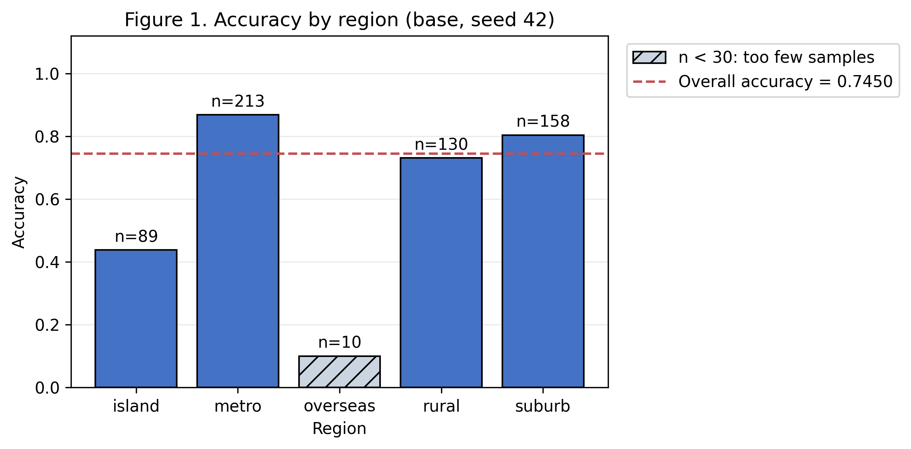
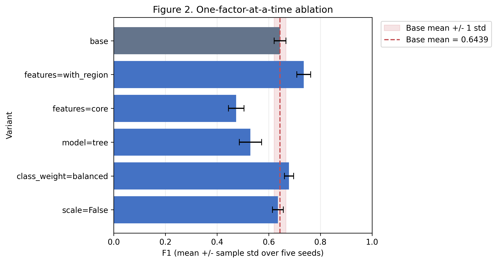
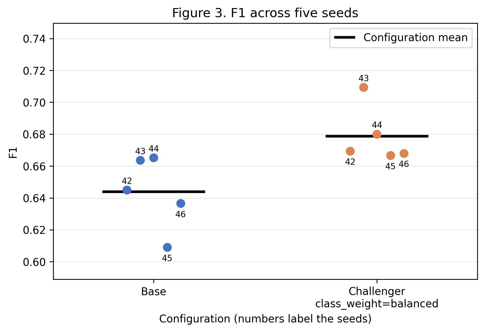

# Lab 8 Report — 20231879 LeeJeongyeon

## 1. What I did

I completed the four TODO blocks without changing the supplied helpers, function interfaces, or fixed experiment settings. No additional factors or configurations were added.

## 2. Results

**Table 1. Each factor changed on its own, five seeds each.** Mean F1 summarizes performance across five seeds, Std F1 measures seed-to-seed variation, and the last column indicates whether the absolute difference from base exceeds the base standard deviation of 0.0230.

| Variant | Mean F1 | Std F1 | Difference from base | Larger than the base spread? |
|---------|---------|--------|----------------------|------------------------------|
| base | 0.6439 | 0.0230 | 0.0000 | — |
| features=with_region | 0.7355 | 0.0270 | +0.0916 | Yes |
| features=core | 0.4741 | 0.0302 | -0.1698 | Yes |
| model=tree | 0.5292 | 0.0431 | -0.1147 | Yes |
| class_weight=balanced | 0.6787 | 0.0180 | +0.0348 | Yes |
| scale=False | 0.6358 | 0.0210 | -0.0081 | No |

**Table 2. The base config sliced by region, seed 42.** The n column provides context for each accuracy estimate, with slices below 30 samples retained in the table but excluded from worst-slice selection.

| Region | n | Accuracy | Precision | Recall | F1 |
|--------|---|----------|-----------|--------|----|
| island | 89 | 0.4382 | 0.8485 | 0.3836 | 0.5283 |
| metro | 213 | 0.8685 | 0.7222 | 0.3611 | 0.4815 |
| overseas | 10 | 0.1000 | 0.1000 | 1.0000 | 0.1818 |
| rural | 130 | 0.7308 | 0.7529 | 0.8205 | 0.7853 |
| suburb | 158 | 0.8038 | 0.7333 | 0.6346 | 0.6804 |
| **overall** | 600 | 0.7450 | 0.7277 | 0.5792 | 0.6450 |

## 3. Figures

  

**Figure 1. Accuracy per region against the overall accuracy.** island has the lowest accuracy among slices with at least 30 samples, at 0.4382 compared with 0.7450 overall. overseas has an accuracy of 0.1000 but is excluded from worst-slice selection because it contains only 10 samples.

  

**Figure 2. One factor changed at a time, mean ±1 std over five seeds.** The interval for features=with_region lies entirely above the base band, while features=core and model=tree lie entirely below it. class_weight=balanced and scale=False overlap the base band.

  

**Figure 3. Five seeds each for the base and the challenger.** The lowest challenger F1 is 0.6667, slightly above the highest base F1 of 0.6652. However, the mean ±1 std intervals overlap, giving `overlaps_best=True`.

## 4. Interpretation

Table 1 and Figure 2 show the largest absolute change for `features=core`: a decrease of 0.1698 F1, or approximately 7.38 base standard deviations using the rounded table values. `features=with_region` gives the largest improvement, 0.0916 F1 or approximately 3.98 base standard deviations.

With seed 42, `scale=False` decreases F1 from 0.6450 to 0.6370. Across five seeds, its mean difference of -0.0081 remains smaller than the base standard deviation of 0.0230. In Figure 3, the challenger has a mean F1 that is 0.0348 higher than the base, but their mean ±1 std intervals overlap over [0.6607, 0.6669], giving `overlaps_best=True`.

Table 2 and Figure 1 identify island as the worst slice among those with at least 30 samples, with accuracy 0.3068 below the overall value. `features=with_region` adds region indicators that the base configuration does not use. However, Table 2 reports only the base configuration, so it does not show whether this variant improves island performance. overseas is excluded from worst-slice selection because n=10 is below `min_count=30`.

In metro, accuracy is 0.8685 while recall is only 0.3611. The model correctly classifies 172 of 177 negative samples but identifies only 13 of 36 positive samples, so high accuracy coexists with many missed late deliveries.

## 5. Limitations

Only five seeds were used to estimate the mean and sample standard deviation. Repeating the comparison with more seeds could change these estimates and whether the base and challenger intervals overlap.

## AI & external-code usage
| Tool / Source | Part used for | What I modified & verified myself |
|---------------|---------------|-----------------------------------|
| ChatGPT | Explanation of NumPy, and Matplotlib syntax needed for the TODOs and plots; debugging syntax errors; interpretation of the report requirements; English rewriting of report sentences that I first wrote in Korean; and help drafting the submission README. | I read each TODO and developed the implementation logic myself, then implemented the code using the syntax explanations. I reviewed and modified the code after debugging, checked the generated outputs and plots, wrote the report content in Korean before asking ChatGPT to refine it in English, and reviewed the final README before submission. |